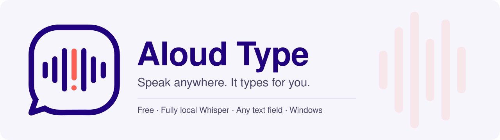
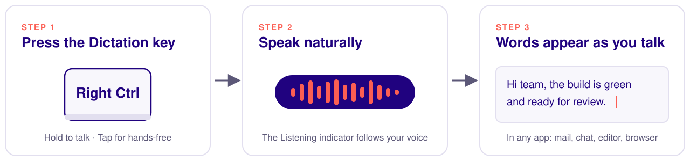

<p align="center">
  <picture>
    <source media="(prefers-color-scheme: dark)" srcset="docs/readme/banner-dark.svg">
    
  </picture>
</p>

<p align="center">
  <a href="https://github.com/radzap/Aloud-Type/releases/latest"></a>
  <a href="https://github.com/radzap/Aloud-Type/actions/workflows/ci.yml"></a>
  
  <a href="LICENSE"></a>
</p>

**Aloud Type** is a free desktop app that types what you say into whatever text field has focus: email, chat, your code editor, a browser form, anywhere. Speech recognition runs entirely on your computer with [Whisper](https://github.com/ggerganov/whisper.cpp). There are no accounts, no cloud and no telemetry.

<p align="center">
  <picture>
    <source media="(prefers-color-scheme: dark)" srcset="docs/readme/how-it-works-dark.svg">
    
  </picture>
</p>

## Features

- **Works in any app.** Text goes into the focused field, wherever it is. No plugins or integrations needed.
- **Streaming insertion.** Words are typed while you are still talking, not after you stop.
- **Fully local and private.** The Speech model is downloaded once. After that the app makes no network calls, and your audio never leaves your machine.
- **GPU acceleration.** Uses your graphics card through Vulkan when one is available, with automatic fallback to the CPU.
- **Hold or tap.** Hold the Dictation key to talk, or tap it once for hands-free dictation.
- **Clear feedback.** A small Listening indicator shows that the app hears you, and turns red (or amber) with a reason when it can't hear you or can't type.
- **Stays out of the way.** No main window: Aloud Type lives in the system tray.
- **Free software.** Licensed under the AGPL v3.

## Install

Download the latest release from the [**Releases page**](https://github.com/radzap/Aloud-Type/releases/latest). Pick one:

| Download | What it is |
| --- | --- |
| `AloudType-<version>-setup.exe` | Per-user installer. Needs no administrator rights and adds a Start menu entry. |
| `AloudType-<version>-portable.zip` | Unzip anywhere and run `aloud-type.exe`. Keep `aloud-type-settings-ui.exe` next to it, because it is the Settings window. |

Each release also includes `SHA256SUMS.txt` so you can verify your download.

> [!NOTE]
> Releases are not code-signed yet. Windows SmartScreen may warn on first run: choose **More info**, then **Run anyway**. Some managed Windows 11 machines block unsigned apps from using the microphone.

**Requirements:** Windows 10 or 11 (64-bit), a microphone, and a CPU with AVX2 (Intel Haswell / AMD Zen or newer). A GPU with Vulkan support is optional but makes larger models fast.

## Getting started

1. **Launch Aloud Type.** On first start the Settings window opens.
2. **Download a Speech model.** One click in Settings. The default, *Base (multilingual)*, is about 60 MB.
3. **Close Settings.** The app settles into the tray.
4. **Click into any text field and dictate** with the Dictation key (**Right Ctrl** by default):

   | Do this | What happens |
   | --- | --- |
   | **Hold** the key while you speak | Dictation runs until you let go |
   | **Tap** the key | Hands-free Dictation starts. Press the key again to stop |
   | Press **another key while holding** a modifier Dictation key (for example Right Ctrl + C) | Dictation is cancelled and your normal shortcut goes through |

To change settings later, or to exit, use the tray icon.

## Settings

| Setting | Options |
| --- | --- |
| Dictation key | Any key or key combination |
| Microphone | System default or a specific device |
| Speech model | See the table below |
| Language | Auto-detect or a fixed language (English by default) |
| GPU | Auto, CPU only, or a specific graphics card |
| Model memory | Keep loaded (instant start) or unload when idle (saves memory) |
| Listening indicator | Trace strip, bar pill or orb; placed top or bottom, left, centre or right |
| Launch at login | Off by default |

### Speech models

All models are quantised [whisper.cpp](https://huggingface.co/ggerganov/whisper.cpp) models (MIT licence). They are verified by SHA-256 before use.

| Model | Size | Good for |
| --- | --- | --- |
| Base (multilingual) | 60 MB | **Default.** Good balance on most PCs |
| Small (multilingual) | 190 MB | Better accuracy, needs a faster CPU or a GPU |
| Base (English only) | 60 MB | English speakers, slightly more accurate than multilingual Base |
| Small (English only) | 190 MB | English, higher accuracy |
| Tiny (English only) | 32 MB | Older or low-power PCs |
| Large v3 turbo | 574 MB | Best accuracy, needs a GPU |

## Privacy

- Audio is processed in memory on your computer and is never uploaded.
- The only network access is downloading Speech models from Hugging Face, when you ask for it.
- No accounts, telemetry or update checks. To update, download a new release.
- Settings and models are stored in `%LOCALAPPDATA%\AloudType`. The installer and the portable zip share this folder, so upgrades keep your settings. The uninstaller asks before deleting it.

## Building from source

Prerequisites:

- [Rust](https://rustup.rs/) (stable) with the MSVC toolchain and Visual Studio Build Tools (C++)
- [CMake](https://cmake.org/) and [LLVM](https://llvm.org/) (set `LIBCLANG_PATH` to LLVM's `bin` folder), used to build whisper.cpp
- Optional: the [Vulkan SDK](https://vulkan.lunarg.com/) for GPU support
- Optional: [Inno Setup 6](https://jrsoftware.org/isinfo.php) to build the installer

```sh
# Debug build and tests (CPU only)
cargo build --workspace
cargo test --workspace

# Run it
cargo run -p aloud-type-app

# Release build: GPU-enabled binaries, portable zip and installer in dist/
python scripts/release.py
```

`scripts/release.py --cpu-only` skips the Vulkan backend. Release builds go to a short target folder (`<drive>:\aloudtype-build` by default, or `ALOUDTYPE_TARGET_DIR`) because the Vulkan build's nested paths would exceed Windows' 260-character limit.

### Project layout

| Crate | Responsibility |
| --- | --- |
| [`crates/app`](crates/app) | The resident tray process that wires everything together |
| [`crates/core`](crates/core) | Platform-free logic: dictation lifecycle, streaming, listening faults |
| [`crates/recognizer`](crates/recognizer) | Whisper speech recognition (CPU and Vulkan) |
| [`crates/models`](crates/models) | Speech model catalogue and checksum verification |
| [`crates/config`](crates/config) | Settings, state and file locations |
| [`crates/platform-windows`](crates/platform-windows) | Keyboard hook, audio capture, text injection, tray and overlay |
| [`crates/settings-ui`](crates/settings-ui) | The Settings window, including model downloads |

Project vocabulary (Dictation, Listening indicator, Tray presence and so on) is defined in [GLOSSARY.md](GLOSSARY.md).

## Contributing

Issues and pull requests are welcome. CI builds and tests every change on Windows and checks dependency licences with `cargo deny`. Every successful build of `main` publishes a new release automatically.

## License

Aloud Type is free software under the [GNU Affero General Public License v3.0 or later](LICENSE). Speech models are provided by the whisper.cpp project under the MIT licence. Third-party components are listed in `THIRD-PARTY-NOTICES.txt` in each release.
